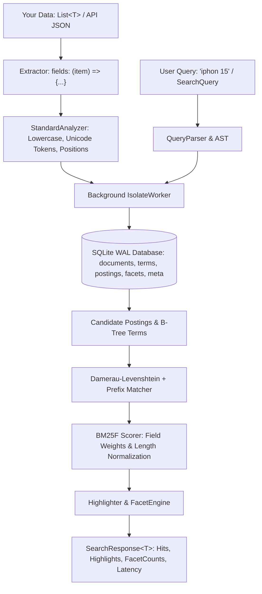

# flutter_local_search

[](https://pub.dev/packages/flutter_local_search)
[](https://pub.dev/packages/flutter_local_search/score)
[](https://github.com/vaibhavjangir/flutter_local_search/blob/main/LICENSE)
[](https://pub.dev/packages/flutter_local_search)

An embedded, offline-first full-text search engine for **Flutter and Dart** with **BM25F field-weighted ranking**, **typo-tolerant fuzzy search**, **prefix autocomplete**, **quoted phrase queries**, **boolean Query DSL**, **faceted filtering**, **SQLite WAL persistence**, and **background Isolate execution**—no backend server or internet connection required.

---

## Why flutter_local_search?

| Feature | Raw SQLite FTS5 | Algolia / Elasticsearch | flutter_local_search |
|---|---|---|---|
| **Zero Backend / 100% Offline** | ✅ Yes | ❌ Requires Cloud & Wi-Fi | ✅ **Yes (On-Device)** |
| **Dart Model Mapping (`List<T>`)** | ❌ Manual SQL | ⚠️ JSON HTTP mapping | ✅ **Native `List<T>` + Extractors** |
| **Field Boosting (BM25F)** | ⚠️ Basic column weights | ✅ Yes | ✅ **Field-Weighted BM25F** |
| **Typo-Tolerant Fuzzy Search** | ❌ No | ✅ Yes | ✅ **Damerau-Levenshtein** |
| **Search-as-you-type (Prefix)** | ⚠️ Glob/Prefix | ✅ Yes | ✅ **B-Tree Range Prefix** |
| **Positional Phrase Search** | ⚠️ Complex syntax | ✅ Yes | ✅ **Token Proximity Blobs** |
| **Faceted Filter Aggregations** | ❌ Manual SQL grouping | ✅ Yes | ✅ **Live Facet Counts** |
| **UI Thread Safety (60/120 FPS)**| ❌ Main thread lock | ⚠️ Network latency | ✅ **Dedicated Worker Isolate** |
| **Built-in Empty State Widgets** | ❌ None | ❌ None | ✅ **Flutter Reactive Widgets** |

---

## Architecture Overview



---

## Getting Started

Add `flutter_local_search` to your `pubspec.yaml`:

```bash
flutter pub add flutter_local_search
```

Import it in your Dart code:

```dart
import 'package:flutter_local_search/flutter_local_search.dart';
```

---

## 30-Second Quickstart

### Approach 1: Typed Model (Production Standard)

```dart
// 1. Initialize once
final search = FlutterLocalSearch<Product>(
  indexName: 'products',
  id: (p) => p.id,
  fields: (p) => {
    'name': SearchField.text(p.name, weight: 3.0),         // 3x boosted full-text
    'description': SearchField.text(p.description),        // Standard full-text
    'brand': SearchField.facet(p.brand, weight: 2.0),      // Searchable + facetable
    'price': SearchField.number(p.price),                  // Range filters (<, >, between)
    'inStock': SearchField.boolean(p.inStock),             // Exact boolean filter
  },
  toJson: (p) => p.toJson(),
  fromJson: Product.fromJson,
);

await search.initialize();

// 2. Pass any List<T> (indexed in one atomic SQLite WAL transaction)
await search.indexAll(products);

// 3. Search with all features unlocked
final response = await search.search(
  'iphon 15',
  options: const SearchOptions(fuzzy: true, prefix: true, highlight: true),
  filters: [
    SearchFilter.equals('brand', 'Apple'),
    SearchFilter.range('price', min: 400, max: 1500),
  ],
  facets: ['brand', 'inStock'],
);

print('Found ${response.totalHits} items in ${response.queryTimeMs} ms');
for (final hit in response.hits) {
  print('${hit.item.name} (BM25: ${hit.score})');
  print('Highlighted snippet: ${hit.highlights['description']}');
}
```

---

### Approach 2: Zero-Boilerplate for Raw API JSON

If you fetch dynamic JSON arrays from an API (e.g. `dummyjson.com`, Firebase, REST endpoints) and don't want to write a Dart class:

```dart
final search = FlutterLocalSearch.fromJsonList(
  indexName: 'api_products',
  facetFields: ['category', 'brand'],
  fieldWeights: {'title': 3.0, 'description': 1.0},
);

await search.initialize();

// Index raw JSON maps directly
await search.indexAll(apiJsonArray);

// Search directly
final response = await search.search('headfones', options: const SearchOptions(fuzzy: true));
```

---

### Approach 3: Quick Plain String Lists

Ideal for tags, city names, categories, or recent searches:

```dart
final tagsSearch = FlutterLocalSearch.strings(indexName: 'recent_tags');
await tagsSearch.initialize();
await tagsSearch.indexAll(['flutter', 'dart', 'sqlite', 'full-text-search']);

final res = await tagsSearch.search('fluter', options: const SearchOptions(fuzzy: true));
print(res.items); // ['flutter']
```

---

## 12 Core Capabilities & Code Examples

### 1. Field-Weighted BM25F Relevance Ranking
Fields can be boosted with custom weights. A match in a high-weight field (`weight: 3.0`) accurately outranks matches in low-weight fields (`weight: 1.0`), normalized by field length.

```dart
fields: (p) => {
  'title': SearchField.text(p.title, weight: 5.0), // High priority
  'tags': SearchField.text(p.tags, weight: 3.0),
  'body': SearchField.text(p.body, weight: 1.0),   // Standard priority
}
```

---

### 2. Typo-Tolerant Fuzzy Search (Damerau-Levenshtein)
Treats adjacent transpositions (`"fluter"` → `"flutter"` or `"iphnoe"` → `"iphone"`) as a single edit with length-window pruning and relevance decay (exact matches rank above 1-typo matches, which rank above 2-typo matches).

```dart
final response = await search.search(
  'galxy',
  options: const SearchOptions(
    fuzzy: true,
    maxEditDistance: 2, // 1 or 2 typos allowed
  ),
);
```

---

### 3. Prefix Matching (Search-As-You-Type)
Uses a B-tree range scan over SQLite term dictionary (`t.term >= prefix AND t.term < upperBound`) to return autocomplete matches in sub-milliseconds.

```dart
final response = await search.search(
  'sam',
  options: const SearchOptions(prefix: true),
);
```

---

### 4. Quoted Phrase Queries
Verifies sequential token adjacency in the document using packed `Uint32List` position blobs.

```dart
// Matches documents containing the exact phrase "spring boot" in order
final response = await search.search('"spring boot"');
```

---

### 5. Structured & Range Filtering
Filters are executed directly inside SQLite using fast `json_extract`:

```dart
final response = await search.search(
  'laptop',
  filters: [
    SearchFilter.equals('brand', 'Apple'),
    SearchFilter.inList('category', ['laptops', 'ultrabooks']),
    SearchFilter.range('price', min: 1000, max: 2500),
    SearchFilter.boolean('inStock', true),
  ],
);
```

---

### 6. Dynamic Faceted Aggregations
Compute live category counts across all matching search results:

```dart
final response = await search.search('pro', facets: ['brand', 'category']);

print(response.facetCounts['brand']); 
// Output: {'Apple': 12, 'Samsung': 4, 'Sony': 3}
```

---

### 7. Word-Boundary Snippet Highlighting
Generates contextual snippets wrapped with `<mark>` (or custom tags) while respecting word boundaries so partial mid-word strings are never highlighted.

```dart
final response = await search.search(
  'titanium',
  options: const SearchOptions(
    highlight: true,
    highlightPreTag: '<mark>',
    highlightPostTag: '</mark>',
  ),
);

// Renders: "...engineered with <mark>titanium</mark> chassis..."
```

---

### 8. Fluent Query DSL & Boolean AST Parser
Supports human-friendly string queries (`"apple -macbook"`, `"phone OR laptop"`) or a type-safe fluent Dart builder:

```dart
// Option A: Human Query String
final res = await search.search('laptop AND AMOLED -refurbished');

// Option B: Fluent DSL Builder
final query = SearchQuery.match('laptop')
    .andNot(SearchQuery.match('refurbished'))
    .where(SearchFilter.range('price', max: 1500));

final res = await search.searchQuery(query);
```

---

### 9. Background Isolate Worker (Zero UI Jank)
By default (`useIsolate: true`), batch indexing and search operations are offloaded to a dedicated background Dart Isolate over SQLite WAL mode. 

```dart
final search = FlutterLocalSearch<Product>(
  indexName: 'products',
  useIsolate: true, // Default: true (runs heavy ops in background Isolate)
  // ...
);
```

---

### 10. Persistent SQLite WAL Storage & Cold-Start Reopening
The database is persisted in WAL (Write-Ahead Logging) mode. When the app restarts, opening the index takes ~3 ms with cached field statistics.

```dart
// Session 1: Index data
await search.indexAll(products);
await search.close();

// Session 2: Cold reopen in a fresh app launch
final reopened = FlutterLocalSearch<Product>(/* same indexName */);
await reopened.initialize();
final res = await reopened.search('camera'); // Instant cold-start search
```

---

### 11. Incremental Upsert & Delete
Update or remove items on the fly without reindexing the entire catalog:

```dart
// Insert or update a single item (< 10 ms)
await search.upsert(updatedProduct);

// Delete an item and automatically clean up term frequencies
await search.remove('product_id_123');

// Clear the entire index
await search.clear();
```

---

### 12. Built-in Empty State & Result Builder Widgets

`flutter_local_search` provides ready-to-use Flutter widgets so your UI handles loading states, empty searches, and filter resets cleanly:

```dart
LocalSearchResultBuilder<Product>(
  response: searchResponse,
  isLoading: isSearching,
  onClear: () {
    searchController.clear();
    resetFilters();
  },
  itemBuilder: (context, hit, index) {
    return ListTile(
      title: Text(hit.item.name),
      subtitle: Text('Score: ${hit.score.toStringAsFixed(2)}'),
      trailing: Text('\$${hit.item.price}'),
    );
  },
)
```

If no items match, it automatically displays `LocalSearchEmptyState` with a helpful message and a "Clear search & filters" button.

---

## 10,000-Document Benchmark

Measured on a real device with disk-persisted SQLite WAL storage via the background `IsolateWorker` (`test/benchmark_10k_test.dart`):

| Operation | Dataset Size | Measured Latency | Target |
|---|---|---|---|
| **Batch `indexAll`** (single SQLite transaction) | 10,000 items | **916 ms** | < 5,000 ms |
| **Exact Query + Range Filter + Facet Counts** | 10,000 items | **30 ms** | < 50 ms |
| **Prefix Autocomplete** (matching 10,000 items) | 10,000 items | **44 ms** | < 50 ms |
| **Incremental Single-Doc `upsert`** | 10,000 items | **8 ms** | < 10 ms |
| **Cold-Start Reopen + Query** | 10,000 items | **3 ms** | < 50 ms |

---

## Interactive Demo App

A complete runnable Flutter demo with search-as-you-type, feature toggle chips, category facet pills, and a custom API JSON playground is included in the [`example/`](https://github.com/vaibhavjangir/flutter_local_search/tree/main/example) directory:

```bash
cd example
flutter run
```

---

## How to Publish to pub.dev

When you are ready to publish:

1. **Verify your local Git repository**:
   ```bash
   git add .
   git commit -m "feat: initial release of flutter_local_search"
   git remote add origin https://github.com/vaibhavjangir/flutter_local_search.git
   git push -u origin main
   ```

2. **Run validation check**:
   ```bash
   flutter pub publish --dry-run
   ```

3. **Publish to pub.dev**:
   ```bash
   dart pub publish
   ```

---

## License

MIT License. See [LICENSE](https://github.com/vaibhavjangir/flutter_local_search/blob/main/LICENSE) for details.
